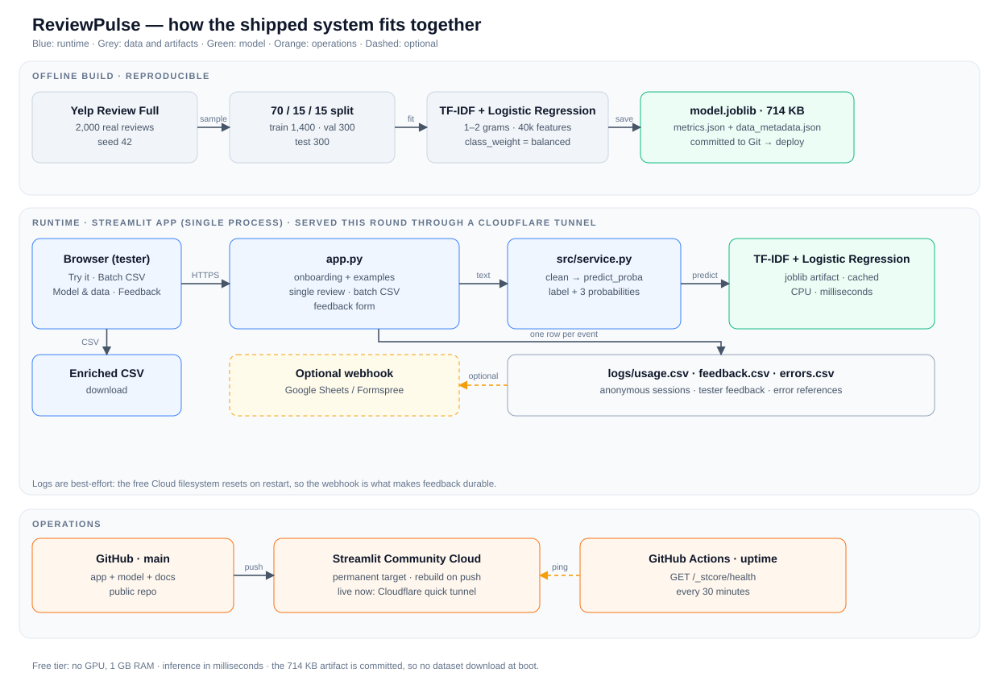
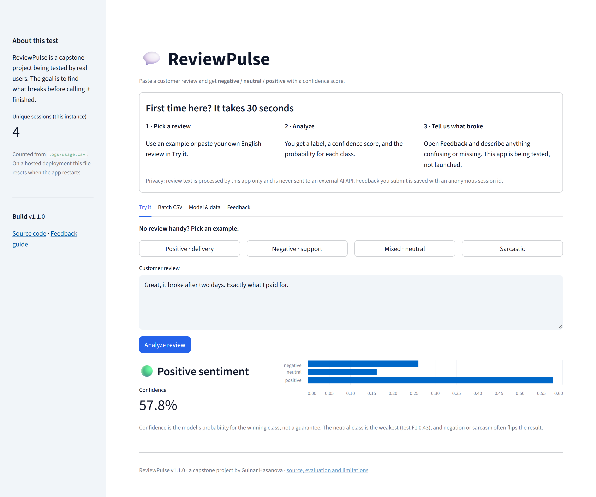

# ReviewPulse: a sentiment model that admits when it is unsure

*A review-triage app for small sellers — and what it cost to make uncertainty visible.*

[Live app](https://bargain-merry-corps-postal.trycloudflare.com) · [Code](https://github.com/HasanovaGulnar/reviewpulse-ai-sentiment-analysis) · [Evaluation report](https://github.com/HasanovaGulnar/reviewpulse-ai-sentiment-analysis/blob/main/reports/EVALUATION.md)

## The problem

A small seller with a few hundred orders a month ends up with thousands of reviews, and the star rating hides what matters. Four 5-star reviews and one detailed complaint about a broken item still average five stars. The complaint is the row that needs an answer today, but finding it means scrolling at midnight or hiring an analyst.

ReviewPulse triages that list. Paste one review or upload a CSV; it returns negative, neutral or positive, a confidence score, and the probability for each class. The batch view adds a summary and a downloadable CSV so a seller can sort by prediction and start with the angry rows.

The hard part was not training a classifier. It was making a deliberately small model useful without letting it sound more certain than it is. A model that confidently calls *"Great, it broke after two days"* positive is worse than no model, because the seller stops checking. Most of the product work went into making failure visible.

## What shipped

*Offline training produces a 714 KB artifact committed to Git; the Streamlit runtime serves single reviews, batch CSV and feedback, with optional durable logging.*

A request goes through one function that normalises the text, runs `predict_proba`, and returns the label, confidence and three probabilities. The same code serves both tabs. Feedback, anonymous session counts and failed predictions go to local CSVs, with an optional webhook. A scheduled GitHub Actions job pings the health endpoint every 30 minutes.

The model is trained offline on 2,000 real Yelp reviews: 1–2 stars → negative, 3 → neutral, 4–5 → positive. Split 70/15/15, seed 42. The 714 KB artifact is committed, so deployment never downloads data or trains at boot.

*The live app after a test review: the winning label, its confidence, and all three probabilities — including the runner-up.*

## Decisions and trade-offs

### 1. A classical model instead of a transformer

The obvious choice in 2026 is a transformer. I used TF-IDF (1–2 word grams, 40k features) plus Logistic Regression. On this laptop a single review takes about 1 ms and 1,000 reviews about 11 ms on CPU; the artifact is 714 KB and the free tier never downloads weights. That matters for a tool opened for thirty seconds.

The trade-off is context. TF-IDF cannot represent negation or sarcasm: the live app labels *"Great, it broke after two days"* positive at 57.8%, and it is bound to Yelp vocabulary. A transformer handles more, but not automatically: in a separate stress test on 15 hand-written negation and sarcasm cases, BERT failed 46.7% of them. A bigger model buys latency and weight, not a guarantee — so uncertainty had to be visible either way.

### 2. Commit the artifact instead of training at boot

Training takes seconds, but a deploy-time training step depends on a dataset download, a network call and a seed at startup. I trained once, reviewed the metrics, and committed the artifact with `metrics.json` and `data_metadata.json`.

The trade-off is coupling: the artifact is valid only for Python 3.13 and scikit-learn 1.7.2, and it can drift if someone rebuilds the splits without retraining. Versions are pinned and the metrics travel with the model, so a stale artifact is visible. For this size reproducibility won; production would retrain in CI and publish a versioned artifact.

### 3. Keep three classes, and show all three probabilities

Binary positive/negative would score better. I kept neutral because it is the category sellers need: the three-star review that is not angry yet. The cost is real: neutral is the weakest class (F1 0.43 on 63 rows) because *"it is okay"* sits between praise and complaint, and the label is noisy for humans too.

Instead of hiding that, the UI shows all three probabilities. Below 50% it warns that the label is a hint, not a verdict. This does not improve the model; it improves the decision made with it.

## Results

On the 300-review held-out test split:

| Class | Precision | Recall | F1 | Support |
|---|---|---|---|---|
| Negative | 0.79 | 0.79 | 0.79 | 116 |
| Neutral | 0.44 | 0.41 | 0.43 | 63 |
| Positive | 0.76 | 0.79 | 0.77 | 121 |

Macro F1 is **0.664**, accuracy **0.71**. Negative and positive are usable for triage; neutral is not. 21 of 63 neutral reviews were predicted positive and 16 negative. Sorting "negative first" finds most complaints, but a three-star complaint can disappear into the positive pile.

What this does not prove: 300 reviews from the same Yelp sample, not a real shop; 2,000 reviews is a baseline, not a stable neutral estimate. Confidence is uncalibrated: 0.7 is not "70% correct". The app is English-only, has no authentication, caps batches at 5,000 rows, and its logs are ephemeral on the free tier without a webhook. The live link is a temporary tunnel, not a permanent deployment.

## What I'd improve

- **Calibrate confidence** with isotonic regression or temperature scaling, and report expected calibration error next to F1; the 50% threshold is a guess.
- **Fix the neutral label before adding capacity.** Write a rubric for 3-star reviews and measure annotator agreement; the class definition is the bottleneck, not the classifier.
- **Benchmark a transformer on the same split**, comparing latency, size and macro F1.
- **Collect seller data and add a per-product breakdown**; the model has never seen the vocabulary of the shops it is meant to help.
- **Make feedback durable and retrain on it**, turning the feedback loop into a data loop.

The evaluation reports, deployment guide and test suite are in the repository.
